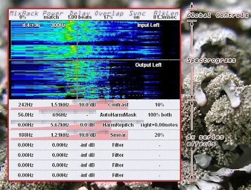
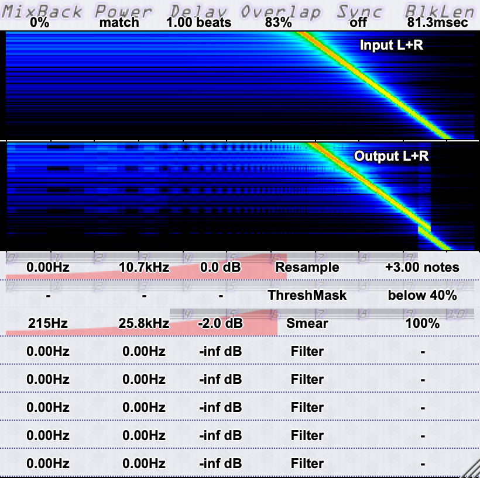

# DtBlkFx for Mac

DtBlkFx is Darrell Tam's classic FFT block effect, now running natively on both Apple Silicon and
Intel Macs as an AU and a VST3. It is an unofficial port of the original Windows VST2 plug-in: it
sounds and looks like the original, and it loads the original's `.fxp` and `.fxb` presets.



## How it was done

- The original Windows source code (by Darrell Tam, from Dozius's x64 fork) was taken as it was.
- The sound engine was kept nearly untouched. Only a handful of small fixes were needed for it to
  build on a Mac, and each one is marked in the code.
- The old Windows VST2 shell around it was swapped for JUCE, which makes the AU and VST3 versions.
- The original skin was redrawn in JUCE from the original images, at the same size and layout.
- FFTW, the FFT library the engine uses, was built for both chip types.
- It was checked by nulling the output against the input and by running every factory preset, on
  both chip types.

The details are further down.

## What it does

Up to 8 effects in series, applied to blocks of spectrum: filters, contrast, smear, threshold,
clip, resize, resample, frequency and harmonic shifts, harmonic repitch, harmonic filters, sweeps,
masks, vocoding, harmonic matching, and cross and warp mixing. Two live spectrograms show the input
and output. The original manual is in [`docs/manual.html`](docs/manual.html).

## Install

1. Download the release zip and unzip it.
2. Copy the plug-ins:
   - AU: `DtBlkFx.component` to `~/Library/Audio/Plug-Ins/Components/`
   - VST3: `DtBlkFx.vst3` to `~/Library/Audio/Plug-Ins/VST3/` (or `/Library/Audio/Plug-Ins/VST3/`)
3. The builds are ad-hoc signed but not notarised, so macOS quarantines them when they come from a
   browser. Clear the flag once after copying:

   ```
   xattr -dr com.apple.quarantine ~/Library/Audio/Plug-Ins/Components/DtBlkFx.component
   xattr -dr com.apple.quarantine ~/Library/Audio/Plug-Ins/VST3/DtBlkFx.vst3
   ```

4. Restart your DAW and rescan plug-ins. Logic and GarageBand use the AU; Ableton Live can use
   either.

Requires macOS 11 or later. The plug-in is stereo; on a mono track the mono signal goes through
both sides.

## Using it

The editor works like the original:

- Left-click and hold a value and drag sideways: that is the coarse slider. Move **up** first
  for the fine (15x) slider. While dragging, moving onto the other bar switches to it without
  changing the value.
- Right-click (or ctrl-click) a value for its menu of presets.
- Shift-drag or right-drag a frequency to move both frequencies of that slot together.
- Mouse wheel or trackpad scroll nudges a value (ctrl or cmd for fine). Momentum scrolling after
  you let go of the trackpad is ignored.
- Click a spectrogram to choose what it shows (input or output, left, right or both, or pause).
- The window can be scaled from the bottom-right corner; at 100% it is the original 410 x 409.

### Presets

- The 43 factory programs are the host's program list.
- **Load and save `.fxp` / `.fxb`:** click either spectrogram; the bottom of that menu has
  "Load preset / bank", "Save preset (.fxp)" and "Save bank (.fxb)".
- **Drag and drop** a `.fxp` or `.fxb` onto the editor to load it.
- Files saved here use the same chunk format and plug-in ID (`h526`) as the Windows plug-in, so
  they open in the original and the original's files open here. Plain parameter-list presets
  (`FxCk` / `FxBk`), which some hosts write, load too.

## Build from source

You need Xcode (or the Command Line Tools), CMake 3.22+, Ninja and
[JUCE](https://github.com/juce-framework/JUCE) 9.0.2.

```
# 1. FFTW for both architectures (downloads FFTW 3.3.11 from fftw.org and checks its checksum)
tools/build_fftw_universal.sh

# 2. Build AU, VST3, Standalone and the test harness
cmake -S . -B build -G Ninja -DCMAKE_BUILD_TYPE=Release
ninja -C build
```

Outputs land in `build/DtBlkFx_artefacts/Release/{AU,VST3,Standalone}`, universal (arm64 and
x86_64) and ad-hoc signed.

- JUCE is looked for as an installed package under `~/JUCE/install`. Pass
  `-DCMAKE_PREFIX_PATH=/path/to/JUCE/install` if yours is elsewhere.
- Without step 1, CMake falls back to Homebrew's FFTW (`brew install fftw`) and warns that the
  build will be Apple Silicon only. Point `-DFFTW_ROOT=` at any other FFTW prefix with a static
  `libfftw3f.a`.
- `tools/package.sh` builds and zips the AU and VST3 with this README and the licences into
  `release/DtBlkFx-mac-<version>.zip`.

### Tests

```
python3 -I tools/verify.py                              # needs numpy and scipy; prints ALL OK
DTBLKFX_HARNESS_ARCH=x86_64 python3 -I tools/verify.py  # the same on the Intel slice (Rosetta)
auval -v aufx DtBk Wool                                 # after installing the AU
```

`verify.py` drives the offline harness (`build/DtBlkFxHarness_artefacts/Release/DtBlkFxHarness`)
and checks:

- Dry (Mixback 100%): the output is bit-identical to the delayed input.
- Wet with every slot a 0 dB filter: nulls against the delayed input at about -137 dB.
- A 1 to 4 kHz filter notch removes about 80 dB in band; the other effects change the spectrum.
- All 44 programs give finite, non-silent output with fixed and random host block sizes.
- Run to run, the output is identical.
- `.fxp` and `.fxb` files in all four VST2 forms load, save and round-trip exactly
  (fixtures in `tests/fixtures`, written from the VST 2.4 file layout).
- The editor: simulated drags, clicks and the wheel set the right parameters. The Fine / Coarse
  popup sliders, opened on cells in every corner at 1x, 1.5x and 2x, sit inside the editor, line
  up with the clicked cell, keep clear of the value being edited, stay inside when dragged past
  the edges, and leave nothing behind when closed (snapshots in `build/verify/popup`; examples
  in `docs/popup-*.png`).
- Drags are stable: a sideways drag starts moving the value at once and the value follows the
  pointer at a fixed rate, picking a bar never changes the value, and every slider at 1x, 1.5x
  and 2x shows no drift without movement and no acceleration (`DtBlkFxHarness drag`).
- The arm64 and x86_64 slices give the same output to float rounding on most programs. Programs
  that pick pitches or peaks (Repitch, HarmShift, Resample and a few others) can make a different
  choice from a last-bit difference and drift further apart; the same happens on arm64 alone just
  by switching fused multiply-add off, so it is not a porting fault.

## Layout

| Path | What |
| --- | --- |
| `Source/engine/` | The original DtBlkFx engine. Changes are marked "JUCE port" in comments |
| `Source/PluginProcessor.*` | JUCE AudioProcessor wrapper (what the VST2 host used to do) |
| `Source/PluginEditor.*`, `Source/gui/` | The original editor rebuilt in JUCE from the original skin |
| `Source/PresetIO.*` | VST2 `.fxp` / `.fxb` load and save |
| `Source/original_gui/` | The original VSTGUI editor sources, for reference (not compiled) |
| `resources/` | Original stereo skin PNGs and factory presets |
| `tools/` | Test harness, `verify.py`, FFTW build script, packaging script |

44 parameters, in the same order with the same names, 0 to 1 ranges and display text as the VST2
plug-in. Host parameter IDs equal the original VST2 indices, so automation maps one to one.

## Differences from the original

- macOS AU and VST3 (plus a Standalone app) instead of a Windows VST2. Only the stereo build is
  ported.
- Parameter changes take effect at host block boundaries, as with VST2.
- If the output ever goes non-finite, that block is silenced and the engine reset (the original
  would keep putting out NaN).
- Text is anti-aliased Arial and the window can be scaled.
- The Fine / Coarse popup sliders stay inside the plug-in window. The original drew them as
  separate screen windows that could hang outside it. Where they fit, they sit exactly where the
  original put them. Where they would not (a value near one end clicked near the opposite edge,
  the top row, the bottom row), they slide back inside or stack on the side with room, and the
  knob is then offset from the mouse pointer instead of sitting under it.
- The popup sliders pick a bar on the first movement in any direction (up = Fine, sideways or
  down = Coarse). The original only looked at vertical movement, so a sideways drag did nothing
  until the hand wobbled, and then the value leapt by the whole sideways distance.

## Credits

- **Darrell Tam** wrote DtBlkFx (2005 to 2006): the engine, the effects, the skin and the manual.
- **Dozius** prepared the source for public release and made the x64 Windows build
  ([github.com/dozius/dtblkfx](https://github.com/dozius/dtblkfx)). This port starts from that
  source.
- **FFTW** 3.3 by Matteo Frigo and Steven G. Johnson (Massachusetts Institute of Technology).
- Mac port: Woolley, 2026.

This is an unofficial port. It is not made or endorsed by Darrell Tam or Dozius. Please report
problems with this port here, not to them.

## Licence

GNU General Public License v3; see [`LICENSE`](LICENSE). The original files say "version 2 of the
License, or (at your option) any later version", and the repository this came from ships the GPLv3
text.

FFTW is free software under the GNU GPL, and is linked statically into the plug-in. Its copyright
notice is in [`docs/FFTW_COPYRIGHT`](docs/FFTW_COPYRIGHT). The FFTW source is available from
[fftw.org](https://www.fftw.org); `tools/build_fftw_universal.sh` builds the exact version used.

VST is a trademark of Steinberg Media Technologies GmbH. Audio Unit is a trademark of Apple Inc.
